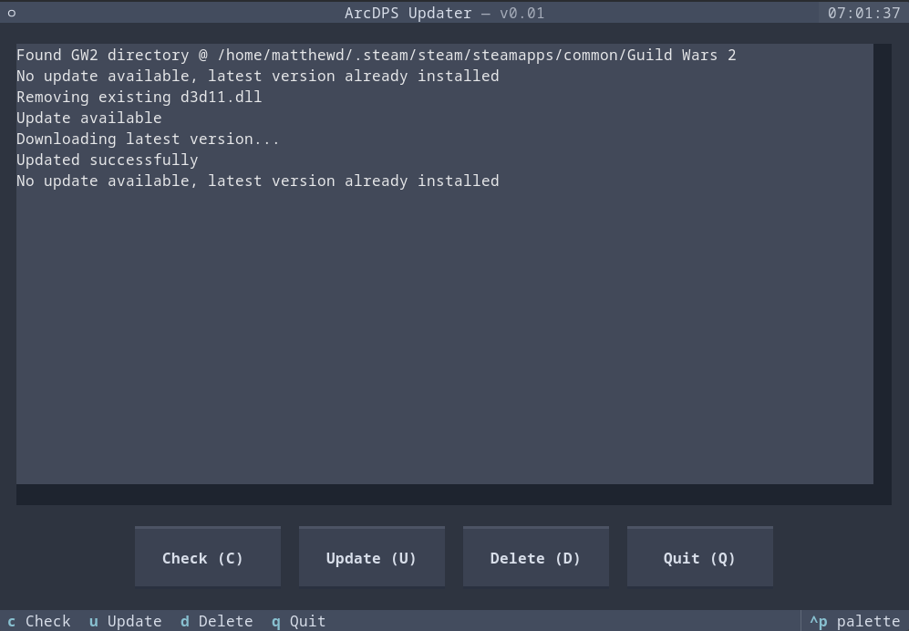

# gw2arcupd

A command-line utility for updating the `d3d11.dll` file used by ArcDPS in Guild Wars 2.



## Prerequisites

- Python 3.8+
- uv (or your virtual environment / package manager of choice)

Uses the following python libraries

- Textual
- httpx

## Installation & Usage

```bash
git clone https://github.com/mdavey/gw2arcupd.git
cd gw2arcupd
uv run gw2arcupd
```

## Key Bindings (in the TUI)

| Key | Action | Description                         |
|-----|--------|-------------------------------------|
| `c` | Check  | Check for available updates         |
| `u` | Update | Download and install the latest DLL |
| `d` | Delete | Delete the existing d3d11.dll       |
| `q` | Quit   | Exit the application                |


## License

MIT License
